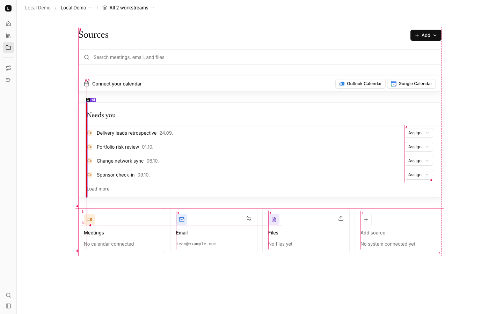
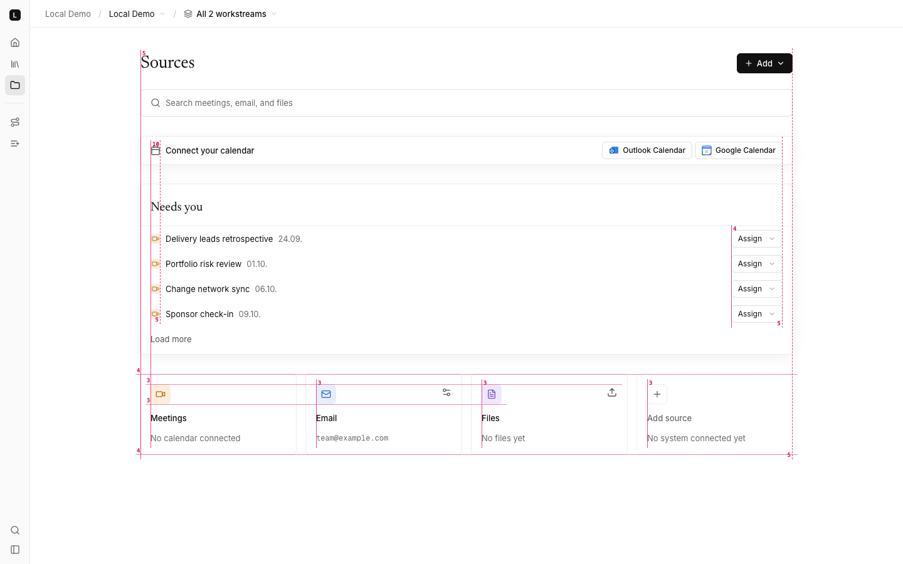

# redline

A design skill for coding agents. It makes the agent the designer of a product's interface, information architecture, and journey: it starts from the known pattern for the job, settles structure and layout before parts and detail, explores directions that differ in kind, and checks its own work with three browser scripts.

## What it sees

`redline.js` runs a guide line wherever three or more things in one column share an edge, boxes whatever sits 1 to 3px (red) or 4 to 8px (orange) off one, and numbers the checks worth fixing, each with the CSS edit. The same Sources screen before and after a pass with the skill:

| Before | After |
| --- | --- |
|  |  |

Fewer lines look calmer: the card contents now start on one edge.

## Install

```sh
npx skills add philippreiner/redline
```

Update an installed copy with `npx skills update`.

## What's inside

| Path | Holds |
| --- | --- |
| `skills/redline/SKILL.md` | Role, principles, how to start, Quick and Full work, the two gates (structure and layout, then parts), modes (explore, consistency pass, new feature, rework, review), lenses, and the critic |
| `skills/redline/references/` | Nine lenses (structure, foundations, components, layout, hierarchy, detail, alignment, words, polish), a pattern library, and click dummies, wireframes, and configurators |
| `skills/redline/scripts/` | `redline.js` (shared left and right edges, near-misses, baselines, and card insets; live in click dummies), `count.js` (siblings, table cells, and controls that break with their group, contrast, and the style inventory, with a panel), `view.js` (bands for rhythm, empty space, collisions, and cut or wrapped text; lead, grid, wireframe, text only, no text, and the long and many stress tests), and `measure.sh` (one ranked list of minimum checks, a fix trial, and before-and-after numbers) |
| `bench/` | Screens with known defects, one fixed screen, and the fix cases for `measure.sh --try`, to check the scripts after a change; not installed with the skill |

## Use

Ask your agent to design, review, or polish a screen; the skill picks up UI work, small tweaks included. The scripts run in any browser. `measure.sh` needs [agent-browser](https://www.npmjs.com/package/agent-browser) and node, and measures the page already open in the agent's browser session, signed in:

```sh
scripts/measure.sh before main      # the minimum checks, then look at the images
scripts/measure.sh --try before 1   # try check 1's edit on the page first
# change the screen
scripts/measure.sh after main
scripts/measure.sh --compare before after
```

In a click dummy, `<script src=".../redline.js"></script>` with live mode keeps the overlay on; Alt+R toggles it.

A project's own design rules, such as a `DESIGN.md`, are the defaults; the skill asks what a world-class expert would do and names any rule it bends.

## License

MIT
