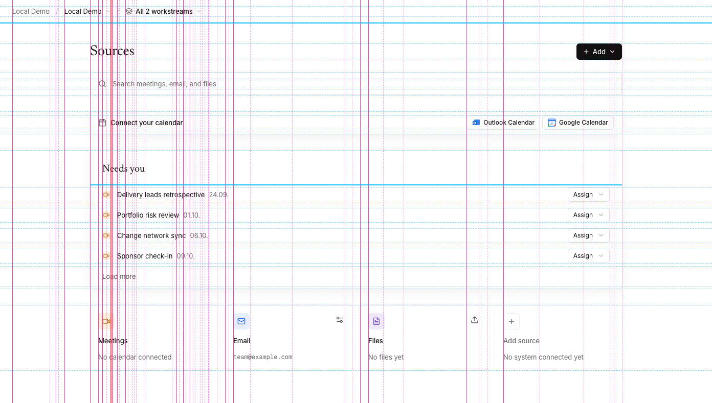
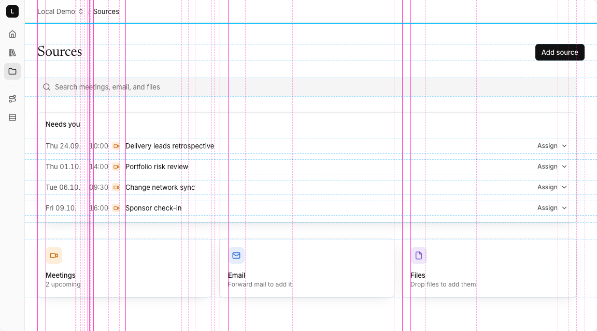

# redline

A design skill for coding agents. It makes the agent the designer of a product's interface, interaction, and journey, and gives it lenses, numbers, and browser scripts to check its own work: alignment overlays, a heatmap of parts that should match, stress tests for long text and long lists, and a text-only read of the screen.

## What it sees

The layout meter draws every left edge in magenta, every box edge in dashed blue, and marks near-misses in red. The same Sources screen before and after a pass with the skill:

| Before: 20 left edges, 1 near-miss, 6 boxes | After: 10 left edges, no near-miss, 5 boxes |
| --- | --- |
|  |  |

Fewer lines look calmer: the title, search, list, and tiles now start on one edge, and the dates sit in their own column.

## Install

```sh
npx skills add philippreiner/redline
```

## What's inside

| Path | Holds |
| --- | --- |
| `skills/redline/SKILL.md` | Role, principles, levels, modes (explore, consistency pass, new feature, rework, review), the lens process, the critic loop, and the lens table every answer ends with |
| `references/` | Eight lenses (foundations, components, layout, hierarchy, detail, alignment, words, polish), a pattern library, and click dummies |
| `scripts/` | Browser scripts that measure a page; `measure.sh` runs them all and compares before with after |
| `bench/` | Three screens with known defects, to check the skill after a change |

## Use

Ask your agent to design, review, or polish a screen; the skill picks up UI work. The scripts run in any browser. `measure.sh` needs [agent-browser](https://www.npmjs.com/package/agent-browser) and node; from the installed skill folder:

```sh
scripts/measure.sh http://localhost:3000/settings before main
# change the screen
scripts/measure.sh http://localhost:3000/settings after main
scripts/measure.sh --compare before after
```

A project's own design rules, such as a `DESIGN.md` and its component library, take precedence over the skill.

## License

MIT
