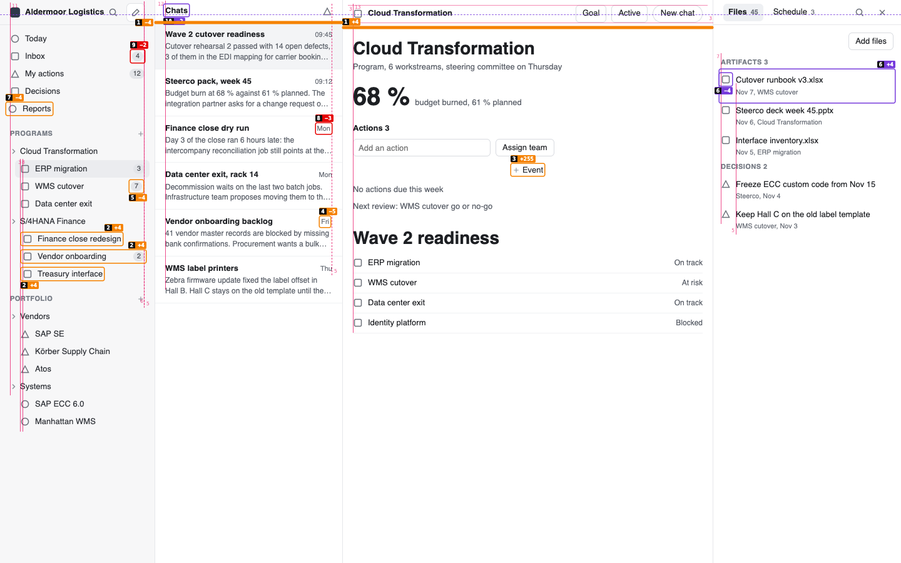
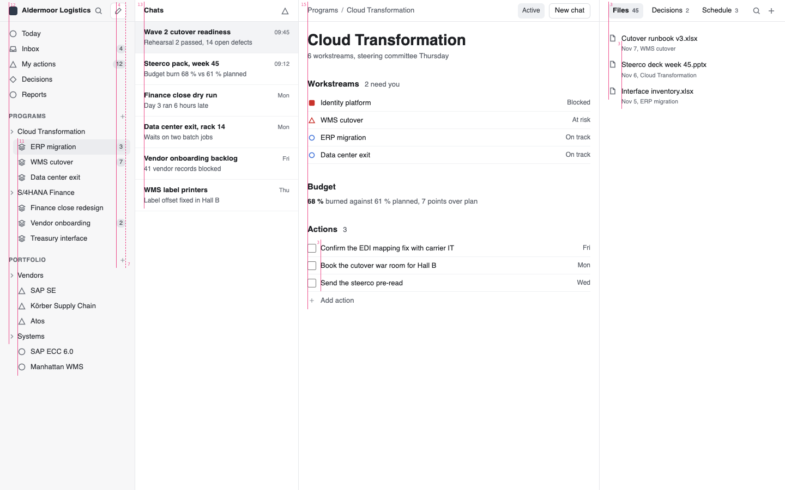

# redline

Coding agents build UI they never look at. redline lets them look. It gives the agent scripts that measure the screen in the browser, like a visual linter, plus design instructions for building better interfaces.

The result: screens that are aligned, balanced, and consistent.

## Install

```sh
npx skills add philippreiner/redline
```

Then ask your agent to design, review, or polish a screen. The skill loads for any UI work, small tweaks included.

## Example

An app shell before and after one pass. Pink lines are shared edges; a red or orange box is something a few pixels off.

| Before | After |
| --- | --- |
|  |  |

Before:

- Pane headers at three different heights
- A button centered while everything around it is left-aligned
- Indents, times, and badges a few pixels off
- A section title as big as the page title
- "Actions 3" above "No actions due this week"

After:

- One header height, everything on its lines
- The page title leads, sections sit one step below
- The workstreams that need attention come first
- Actions as a list, with one "Add action" at the end

## What's inside

| Path | Holds |
| --- | --- |
| `skills/redline/SKILL.md` | How the agent works: measure first, sketch the layout, then fix region by region. Modes for new screens, reviews, and reworks |
| `skills/redline/references/` | Nine checklists (structure, foundations, components, layout, hierarchy, detail, alignment, words, polish), a pattern library, and click dummies |
| `skills/redline/scripts/` | `redline.js` for alignment (edges, pane headers, indents), `count.js` for consistency (sizes, colors, shapes, amount of text, hierarchy, contrast), `view.js` for wireframe, spacing, and stress views, and `measure.sh` to run all three and list what to fix |
| `bench/` | Test screens with known defects, to check the scripts after a change. Not installed |

## Run the scripts

The three scripts are plain JavaScript that runs in any page: paste one into the DevTools console, or run it with Playwright, Puppeteer, or agent-browser. Each draws an overlay and returns JSON.

`measure.sh` runs all three at once. It needs [agent-browser](https://www.npmjs.com/package/agent-browser) and node, and measures the page open in the agent's browser:

```sh
scripts/measure.sh before main      # what to fix, plus images
scripts/measure.sh --try before 1   # test fix 1 on the page first
# change the code
scripts/measure.sh after main
scripts/measure.sh --compare before after
```

In a click dummy, add `<script src=".../redline.js"></script>` to keep the lines on; Alt+R toggles them.

## License

MIT
