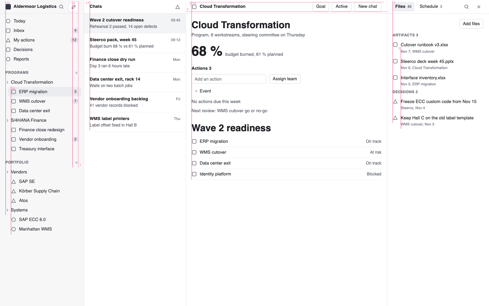

# redline

Your coding agent builds screens it never looks at. redline makes it look. The agent measures the open page and sees guide lines where things should line up. Each defect comes numbered with its CSS fix, and the agent tests that fix on the page before it touches the code.

```sh
npx skills add philippreiner/redline
```

## One pass takes a shell from 12 checks to none

One four-pane app shell, before and after a pass with the skill. Pink lines mark edges that three or more things share; a red or orange box marks something 1 to 8px off one, with its offset.

| Before: 12 checks | After: none |
| --- | --- |
|  |  |

What the pass fixed:

- Pane headers at 36, 40, and 44px now share one 40px band, so their hairlines run as one line.
- "+ Event", centered under start-aligned fields, now starts on their edge.
- One nav group indented 20px where the others use 16px, and one item sat 4px outside its column.
- Times and badges ended 2 to 5px short of their right edge.
- A pill button sat among 6px-radius ones.
- Chat rows carried a title and two lines of preview; they now carry one short line.
- Grey labels read below 4.5:1 contrast.

## The agent measures before it styles

1. Measure the screen as it is, so every change has a baseline.
2. Write the skeleton before styling anything: frame, regions, header bands, the edges content starts on, one axis per region, and what leads.
3. Fix region by region, layout before parts, and try each CSS fix on the page (`measure.sh --try`) before it goes into the code.
4. Hand over before and after, with the numbers that moved.

A project's own design rules, such as a `DESIGN.md`, are the defaults. Where one makes a screen worse, the agent does the better thing and names the rule it bent.

## What's inside

| Path | Holds |
| --- | --- |
| `skills/redline/SKILL.md` | The workflow: baseline, skeleton, parts, the modes (explore, consistency pass, new feature, rework, review), and a critic |
| `skills/redline/references/` | Nine checklists (structure, foundations, components, layout, hierarchy, detail, alignment, words, polish), a pattern library, and click dummies |
| `skills/redline/scripts/` | `redline.js` for edges, pane bands, axes, and indents; `count.js` for shapes, text volume, contrast, and the style inventory; `view.js` for spacing, wireframe, and stress views; `measure.sh` to run all three and rank the checks |
| `bench/` | Screens with known defects, clean screens that must stay quiet, and 86 fix cases; not installed with the skill |

## The scripts run in any browser

`measure.sh` needs [agent-browser](https://www.npmjs.com/package/agent-browser) and node. It measures the page already open in the agent's browser session, so a signed-in app stays signed in:

```sh
scripts/measure.sh before main      # rank the checks, then look at the images
scripts/measure.sh --try before 1   # try check 1's fix on the page
# change the code
scripts/measure.sh after main
scripts/measure.sh --compare before after
```

In a click dummy, `<script src=".../redline.js"></script>` keeps the overlay live; Alt+R toggles it.

## License

MIT
